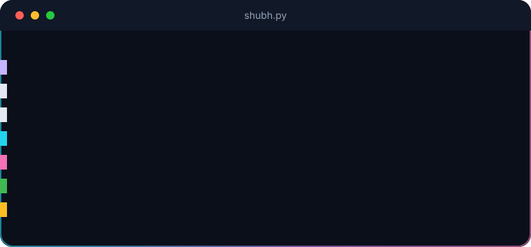
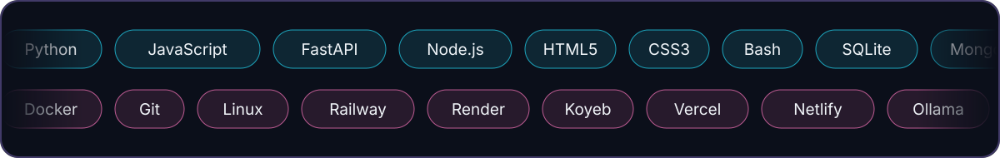
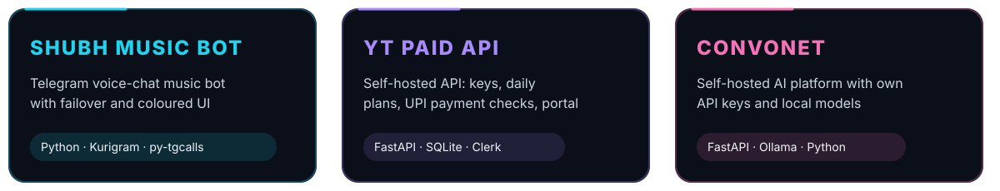

 

## 👨‍💻 About me

## 🛠️ Tech stack

      

    

    

## 🚀 Featured projects

<a href="https://github.com/dev-shubh-madara/Shubh_music_public_bot-">Shubh Music Bot</a> · <a href="https://github.com/dev-shubh-madara/yt-paid-api-bot">YT Paid API</a> · ConvoNET

## 📊 GitHub stats

 

## 📈 Profile summary

 

 

## 🛡️ Protection

## 🚀 Currently

